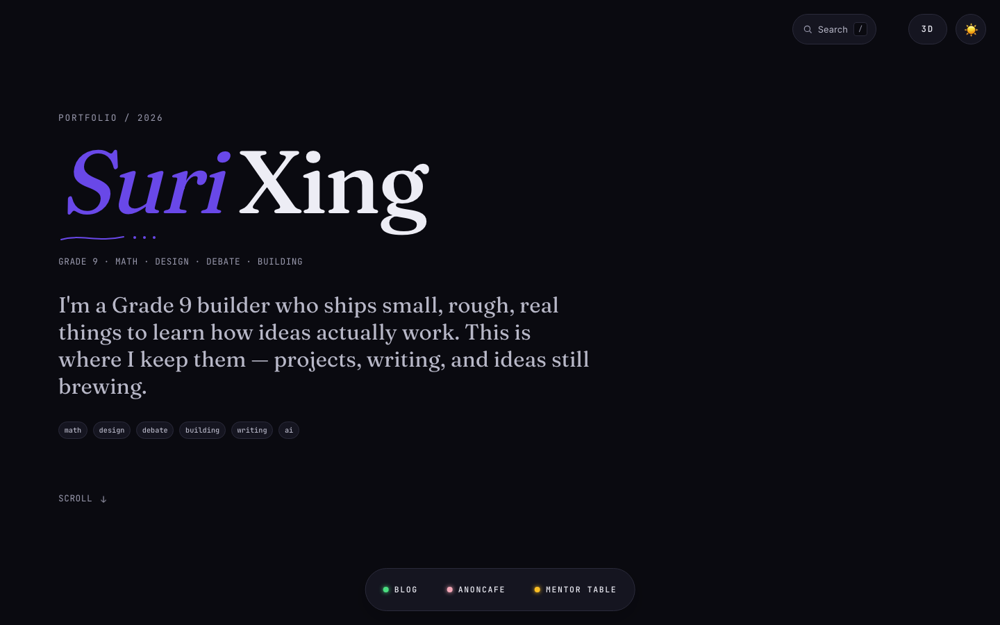

# Suri's Lab



My personal site — an editorial portfolio at [suri.world](https://suri.world), a
playable 3D room, and a blog.

- `/` — 2D editorial landing: work, writing, ideas, about
- `/3d` — explorable 3D room built with React Three Fiber
- `/blog` — Astro blog, built separately and merged into the main build

## Stack

- React 19 + TypeScript + Vite, routed with react-router
- three.js / React Three Fiber / drei for the 3D world
- Astro for the blog (`blog/`)
- Deployed on Vercel — `vercel.json` holds the redirects, rewrites and
  security headers

## Run it locally

```bash
npm install
npm run dev        # site at http://localhost:5173 (the 3D world is lazy-loaded)
```

The blog is its own Astro project under `blog/`, so the full build is:

```bash
npm run build      # type-check + production build of the site
npm run build:all  # site + blog, merged into dist/
npm run lint
```

## Deploy

Production deploys go to Vercel: `npm run deploy`. In production `/anoncafe*`
redirects to `anoncafe.life`, and the 3D smoke tests live in `tests/`
(`npx playwright test`, needs a running dev server).

## Layout

- `src/components/pages` — 2D pages (Landing, Work, Writing, Ideas, About, …)
- `src/components/shared` — dock, search, theme toggle, skip link
- `src/world3d/` — 3D scene, HUD and store
- `src/data/` — canonical content: products, posts, ideas, about
- `blog/` — Astro blog (posts in `blog/src/content/blog`)
- `tests/` — Playwright smoke tests for the 3D world

## Notes

- Content lives in `src/data/`; edit there, not inside page components.
- The 3D world is lazy-loaded so the 2D landing stays light.
- `npm run deploy` targets the `surixing-outlookcoms-projects` Vercel scope.
